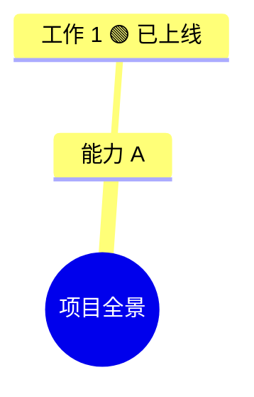

# 谁懂啊😭 一句话让 Claude 写出大厂级飞书文档，领导以为我通宵了

> 思维导图、彩色高亮块、四栏数据卡、架构图、时间线……全是飞书**原生可编辑**的，不是截图！
> 打工人写周报、复盘、阶段总结直接起飞🚀

`feishu-doc` 是一个 [Claude Code](https://claude.com/claude-code) skill。它不用飞书 API，直接操作网页上的飞书编辑器，用的是你自己的登录，所以你能编辑的文档它都能写。

## 🔥 能干啥

- ✍️ **一句话写整篇**：“按复盘模板，把这周的项目写进这篇飞书文档 <链接>”
- 🧠 **原生思维导图 / 流程图 / 饼图 / 时间线 / 甘特图 / 时序图**：Mermaid 直接变成飞书画板，双击能放大，还能继续手动改
- 🎨 **彩色高亮块随便配**：蓝 💡 结论、绿 ✅ 成果、红 🚨 风险、黄 🚀 机会……颜色和图标都能指定
- 📊 **任意列数的分栏**：数据卡片、SWOT 四格、P0/P1/P2 待办、带彩色标签的对比栏
- 🖍️ **彩色文字、背景高亮、彩色标签**：`{red:红字}`、`{bg-green:做得好的}`、`{{blue:标签}}`
- 📖 **读文档、插内容、改字、删块**：改之前先读一遍，不会覆盖你手动改过的内容
- 📋 **5 套模板**：阶段总结、项目复盘、会议纪要、周报、方案。结构和配色是从 13 个飞书官方模板里蒸馏出来的

## 📦 安装（1 分钟）

需要：Claude Code、Node.js 18+、Google Chrome（或 Edge / Chromium）

```bash
git clone https://github.com/golemkit/feishu-doc-yyds.git ~/.claude/skills/feishu-doc
```

Windows 放到 `C:\Users\你的用户名\.claude\skills\feishu-doc`。不用手动装依赖，第一次运行时会自动 `npm install`。它只装一个 playwright-core，不会另外下载浏览器。

## 🚀 第一次使用

1. 在飞书里新建一篇空白文档，复制链接
2. 对 Claude Code 说：“用 feishu-doc 把下面的内容写进这篇飞书文档：<链接>”
3. 会弹出一个**单独的** Chrome 窗口，用飞书 App 扫码登录一次（独立配置目录 `~/.feishu-doc-chrome`，不影响你平时的 Chrome）
4. 之后就不用再登录了，这个窗口可以放后台

装了 ego 浏览器的话会优先用 ego，不用额外设置。

## 🎨 写法速查

````markdown
```callout green ✅
**阶段结论**：本季度上线 3 个功能，{green:交付周期缩短一半}
```
```grid grey 📈 | grey 🚀 | grey ⏰
#### 12 项
{grey:沉淀的基础能力}
---col---
#### 3 个
{grey:上线的新功能}
---col---
#### 1 周
{grey:平均交付周期}
```
```grid plain | plain
{{green:优势}}
- 响应快
---col---
{{red:劣势}}
- 人手不足
```
- {bg-green:**做得好的**} 需求 2 天出原型
- {bg-red:**有待提升**} 文档沉淀不足

````

颜色：`blue green orange red yellow purple grey`。完整说明见 [SKILL.md](SKILL.md)。

## 🧩 原理（给好奇宝宝）

飞书在文档之间复制粘贴时，剪贴板里带着每个块的完整数据（类型、颜色、图标、列宽）。这个 skill 把 Markdown 编译成同样的格式再粘贴进去，所以出来的就是飞书原生的块，不是图片也不是表格嵌入。Mermaid 会被飞书转成可编辑画板，图片走粘贴上传。

## ⚠️ 注意

- 只在 macOS 上完整测过，Windows 还没实测（按键已经适配）
- 表格列宽、分栏宽度不能自动拖，需要手动调
- 画板里的文字改不了，只能重新插入一张图
- 不会删除整篇文档；改别人写的内容前会先问你
- 用的是你自己的飞书登录，请遵守所在公司的数据和安全规定。这不是飞书官方工具
