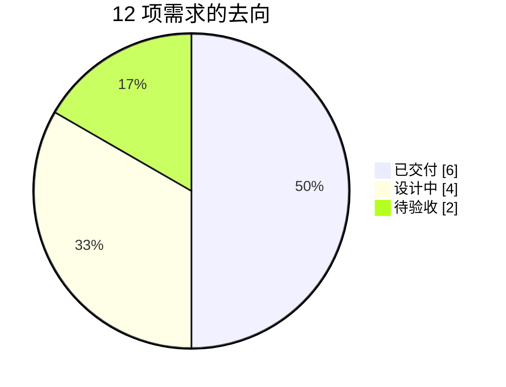
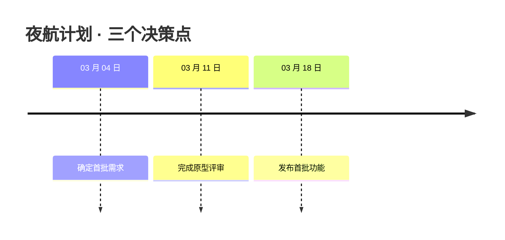

# feishu-doc · 让 AI 写出可编辑的飞书图文报告

把 Markdown 写进已登录的飞书编辑器：交付数字变成分栏卡片，Mermaid 变成画板，正文仍可继续编辑。无需飞书开放平台 API。

## 复制这段，让 AI 安装

把下面整段发给 Claude Code、Codex 或具备本地终端工具的 DeepSeek Harness（dsh）：

```text
请为当前 agent 安装 https://github.com/golemkit/feishu-doc-yyds 的 feishu-doc skill（SKILL.md 在仓库根目录）。优先使用当前 harness 的 skill 安装器；没有安装器就将仓库放到此 harness 实际读取的 skills 目录下，目录名 feishu-doc。已有同名安装先检查来源与本地改动，不要直接覆盖。如果 dsh 未配置技能发现目录，可以保留独立 checkout 并告诉我以后如何显式引用 SKILL.md。检查 Node.js 18+、npm 和 Chrome/Edge/Chromium 是否可用，在安装目录按 package-lock.json 用 npm ci 安装依赖。报告实际安装路径、调用方法，以及是否需要新开会话。安装到此结束，不创建或修改飞书文档。
```

| Harness | 如何调用 | 验证情况 |
| --- | --- | --- |
| Claude Code | 有桌面终端且已安装 ego 时可用 ego；普通终端用 Chrome | 原开发环境；项目已记录两种引擎的 macOS 验证 |
| Codex | 从安装目录运行 `bash scripts/run.sh /绝对路径/task.json --chrome` | 已在 macOS 写入并回读分栏卡片、表格和画板 |
| DeepSeek Harness | 让有终端工具的会话读取安装目录中的 `SKILL.md`，显式传 `--chrome` | 桌面版已读技能并连接飞书；模型上游超时，完整写入尚未验收。headless 需要可用的模型凭据 |

**第一次写入：** 新建一份可编辑的空白飞书文档，复制链接，告诉 AI：「用 feishu-doc 把仓库的 `references/gallery/showcase.md` 写到这个链接，完成后回读，确认有一个三栏布局和三张画板。」按需在技能的独立 Chrome 窗口登录。

## 图表样本册：一组需求，四种看法


[复制整份飞书示例源码](references/gallery/showcase.md)。以下为同一组虚构数据的本地插图与 GitHub Mermaid 预览；飞书中的实际样式由编辑器决定。

| 想回答的问题 | 推荐形式 | 读图提示 |
| --- | --- | --- |
| 做完了多少？ | 三栏数字卡 | 6 项已交付、4 项设计中、2 项待验收 |
| 哪个状态占多数？ | 饼图 | 已交付占 12 项中的一半 |
| 谁接下一棒？ | 带回路的流程图 | 评审通过进入验收；修改退回原型 |
| 何时做了决定？ | 时间线 | 只放改变项目走向的节点 |






## 🎨 写法速查

````markdown
```callout green ✅
**阶段结论**：本季度上线 3 个功能，{green:交付周期缩短一半}
```
```grid grey 📈 | grey 🚀 | grey ⏰
#### 12 项
{grey:沉淀的基础能力}
---col---
#### 3 个
{grey:上线的新功能}
---col---
#### 1 周
{grey:平均交付周期}
```
```grid plain | plain
{{green:优势}}
- 响应快
---col---
{{red:劣势}}
- 人手不足
```
- {bg-green:**做得好的**} 需求 2 天出原型
- {bg-red:**有待提升**} 文档沉淀不足

````

颜色：`blue green orange red yellow purple grey`。完整说明见 [SKILL.md](SKILL.md)。

## 🧩 原理（给好奇宝宝）

飞书在文档之间复制粘贴时，剪贴板里带着每个块的完整数据（类型、颜色、图标、列宽）。这个 skill 把 Markdown 编译成同样的格式再粘贴进去，所以出来的就是飞书原生的块，不是图片也不是表格嵌入。Mermaid 会被飞书转成可编辑画板，图片走粘贴上传。

## ⚠️ 注意

- 只在 macOS 上完整测过，Windows 还没实测（按键已经适配）
- 表格列宽、分栏宽度不能自动拖，需要手动调
- 画板里的文字改不了，只能重新插入一张图
- 不会删除整篇文档；改别人写的内容前会先问你
- 用的是你自己的飞书登录，请遵守所在公司的数据和安全规定。这不是飞书官方工具

## 📄 许可

[MIT](LICENSE)：随便用、随便改、随便分享，保留版权声明就行。
