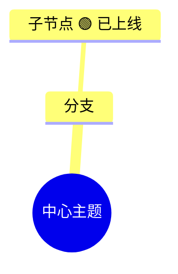

# feishu-doc

There is no Feishu API access; this drives the real editor with the user's login. There are two engines, which share the same task format, ops and helpers:

| engine | when | login |
|---|---|---|
| **ego** | `~/.local/bin/ego-browser` exists (ego lite installed) | the user's ego lite session |
| **chrome** | everyone else: a normal Google Chrome / Edge / Chromium, driven by Playwright | log in once in the dedicated Chrome window |

`run.sh` picks ego when it is installed and Chrome otherwise. Force one with `run.sh <task> --chrome` / `--ego`, or with `FEISHU_ENGINE=chrome|ego`. The ego engine was verified on 2026-11-18 and the Chrome engine on 2026-11-19 (macOS, Chrome 157): every op and rich block below works on both.

## How to run

Use the directory containing this SKILL.md as SKILL_DIR. For Codex and DeepSeek Harness (dsh) pass --chrome explicitly. Claude Code can also use ego when its desktop terminal is available. See the [harness support table](README.md) and the [copyable chart gallery](references/gallery/showcase.md).

1. Write a task JSON to `/tmp/feishu-skill/<name>.json` (ASCII path).
2. Start it with `"$SKILL_DIR/scripts/run.sh" /tmp/feishu-skill/<name>.json --chrome`:
   - **ego**: replace --chrome with --ego. ego-browser fails from the Bash tool, so start it from `mcp__terminal__run_in_terminal` (the terminal rejects non-ASCII commands). Reuse the same tab for later jobs. Then, in the Bash tool, run `"$SKILL_DIR/scripts/wait.sh" /tmp/feishu-skill/<name>.json` (set timeout to 600000).
   - **chrome**: run it straight from the Bash tool (timeout 600000). It prints `done …` when finished. If it may wait for a login, run it with `run_in_background` and then `wait.sh`.
3. The log is `<name>.out`, one line per op: `[i] op ok …` or `FAILED: …`, ending with `EXIT n`.
4. Results are in `<name>.result.json`, plus `<name>.tree.txt`, `<name>.outline.json` and screenshots, depending on the ops.

**ego:** ego lite must already be open (ask the user if `Failed to start ego lite`). The runner keeps one ego task space per doc URL in `/tmp/feishu-skill/state.json`, so the page stays loaded between jobs. It works in its own tab, and the user's open tab updates live. End the last job with `"finish": true`.

**chrome:**
- Needs Node 18+ and Chrome (or Edge or Chromium). On first use, `run.sh` runs `npm install` in the skill folder, which only installs `playwright-core`; no browser is downloaded.
- The first job opens a **separate Chrome window**. It has its own profile (`~/.feishu-doc-chrome`) and a DevTools port (9333), and doesn't touch the user's normal Chrome.
- If Feishu isn't logged in there, the log prints `LOGIN NEEDED`. Tell the user to log in in that window, by scanning the QR code with the Feishu app. The job waits up to 10 minutes and carries on.
- The window stays open between jobs, so the login and the loaded doc are kept. `"finish": true` closes the doc's tab. If the user closed the window, the next job opens a new one (on macOS Chrome keeps running without a window, and Playwright can't attach until a tab exists).
- Settings via env vars: `FEISHU_CHROME_PATH` (browser binary), `FEISHU_CHROME_PORT`, `FEISHU_CHROME_PROFILE`, `FEISHU_LOGIN_WAIT` (seconds) and `FEISHU_DEBUG=1`.
- Without bash (Windows), run `node scripts/run-chrome.mjs <abs task.json>` from the skill folder, after `npm install`. Windows uses `End`, `Shift+Home` and `Control+z` instead of the Mac keys. This hasn't been tested on Windows yet.

**Finding the doc:** when the user says they created or opened a doc, run `"$SKILL_DIR/scripts/recent_docs.sh"` in Bash. It lists recently visited Feishu doc URLs from the ego history and the feishu-doc Chrome profile. Otherwise, ask the user for the link.

## Task file

```json
{
  "url": "https://your-company.feishu.cn/wiki/XXXX",
  "ops": [ { "op": "read" } ],
  "finish": false
}
```

Ops run in order and stop at the first failure. Set `"continueOnError": true` for batches of independent edits.

| op | fields | does |
|---|---|---|
| `read` | — | Whole doc as an indented text tree → `<name>.tree.txt`. **Do this first** when updating a doc: the user often edits it by hand, so build on what is there now. |
| `outline` | — | Top-level blocks `{id,type,text}` → `<name>.outline.json` |
| `write` | `markdown` or `markdownFile`, `title?` | Fill a **new, empty** doc (refuses otherwise) |
| `insert` | `after` (match, or `"end"`), `markdown`/`markdownFile` | New content after a **text or heading** block |
| `edit` | `match`, `text` | Replace one block's text, keeping its type. Bold and other inline formatting are lost |
| `replace` | `match`, `find`, `with` | Replace a substring inside one block. The rest of the block keeps its formatting. Prefer this for wording fixes |
| `stripEmoji` | `match` | Remove a leading emoji (and the space after it) from a heading or paragraph |
| `addAfter` | `match`, `text` | Add a sibling of the same type (bullet, todo…) |
| `delete` | `match` | Delete one top-level block (image, whiteboard, paragraph). Checks that only that block went; undoes otherwise |
| `setTitle` | `text` | Doc title |
| `create` | — | New blank doc in the same wiki as `url`: header "+" → 文档 → 新建空白文档. Returns the new `url`; put it in the next task, starting with `setTitle` and `write`. |
| `clearBody` | `confirm: "created-by-me"` | Select-all + delete in the body. **Only for a doc you created in this session** (scratch or test). Never use it on a doc the user wrote. |
| `screenshot` | `match?`, `file?` | Screenshot, optionally scrolled to a block |
| `shots` | `dir?` | Screenshot the whole doc page by page, for a final review |

**Match** is the exact text of a block (`"六、下一步"`) or an object: `{ "type": "heading2", "text": "…" }`, `{ "startsWith": "…" }`, `{ "includes": "…" }`, `{ "id": "<record id from read/outline>" }`, `"topLevel": true`. The first match in the doc wins, so make it unique. Block types: `text heading1-9 bullet ordered todo quote_container callout grid grid_column table table_cell whiteboard image divider`.

## Markdown that converts

Paste turns plain Markdown into native blocks: `#`–`######`, `-` lists (nest with 4 spaces), `1.`, `- [ ]` todos, `>` quote, `---` divider, `**bold**`, and `|` tables, which become native docx tables with equal column widths (bold the header cells yourself). Blank lines are stripped automatically; otherwise each one becomes an empty paragraph.

Rich blocks are fenced. The runner leaves a placeholder for each, then fills them from the bottom up:

````markdown
```callout blue 💡
**阶段结论**：…
- 要点
```
```grid green 🌱 | blue 🎯 | orange 📌
**左栏**
- …
---col---
**中栏**
---col---
**右栏**
```


````

### Colour, icons and columns

Highlight blocks, column layouts, labels and coloured text are pasted as Feishu's own clipboard records (`scripts/lark.mjs`), so they keep colours and icons exactly, the way a copy between two Feishu docs does.

- **Highlight block (高亮块)**: ```` ```callout <colour> <icon> [flat] ````. Colours: `blue green orange red yellow purple grey`. The icon is an emoji (💡 🎯 📌 🚀 ⚠️ 🚨 ✅ 👍 🌱 📈 📆 ⏰ 🏆 🧩 …) or a gemoji name (`bulb`, `dart`); an unknown one shows as 💡, `none` means no icon. `flat` removes the border. The default is `blue 💡`.
- **Columns (分栏)**: ```` ```grid <spec> | <spec> | … ```` with the columns separated by `---col---`. Any number of columns works; 2 to 4 read well. Each spec is a highlight-block spec, or `plain` for a column without a box, plus an optional width such as `40%`. If there are fewer specs than columns, the last one repeats.
- **Coloured text**: `{red:文字}`. **Highlight**: `{bg-green:文字}`, or `==文字==` for yellow. Both nest with bold: `{bg-green:**做得好的**}`. Links: `[文字](https://…)`.
- **Label**: a line that is only `{{green:竞品名称}}` becomes a centred, bold label on a coloured background. Use it as a column header in a `plain` grid, as the official 分析报告 template does.
- Limits:
  - Feishu doesn't allow tables inside a highlight block, so a table there is dropped. Put tables in a `plain` grid column or in the body.
  - Coloured markup in table cells is removed, keeping the text.
  - A list item with colour markup is pasted on its own and loses its nesting, so keep coloured list items top-level.
  - Markdown `>` quotes are also pasted as records, because a line right after a Markdown quote gets swallowed into it.

### Diagrams and images

- Mermaid becomes an **editable 画板** whiteboard; double-clicking it opens the full-size view. Inside `mindmap` node text, use full-width （）【】： instead of ASCII `()[]{}:"`, which Mermaid treats as syntax. Emoji and `→` are fine. About 90 nodes rendered fine.
- **Which Mermaid types render** (tested 2026-11-18): `mindmap`, `flowchart` (including `subgraph` for layered architecture), `pie`, `gantt`, `timeline`, `sequenceDiagram`, `stateDiagram-v2`, `classDiagram` and `erDiagram` become whiteboards. `quadrantChart`, `xychart-beta` (bar/line), `sankey-beta` and `journey` stay **plain code blocks**, so don't use them. For those charts, render HTML to PNG with headless Chrome (`--screenshot --force-device-scale-factor=2`) and insert the image with ``; see `references/matrix-png-example.py`.
- `gantt` comes out small and is only readable after double-clicking. `timeline` and `pie` read well inline.
- The doc column is about 820 px wide and a whiteboard scales its diagram down to fit it, so a long `flowchart LR` chain (more than 4 or 5 nodes) or a wide `sequenceDiagram` ends up with tiny text. For a process with stages, use `flowchart TB` with one `subgraph` per stage. Keep sequence participants to 5 or fewer, with short names and labels. `classDef` fill colours carry over to the whiteboard.
- To replace a diagram: `insert` the new one, take a screenshot to compare, then `delete` the old whiteboard by id. Delete the empty paragraphs left around it too.
- An HTML `<table>` would become an embedded spreadsheet, so use Markdown tables.

## Style guide

Distilled on 2026-11-19 from 13 of Feishu's official templates: 双月业务总结, 项目复盘, GRAI 复盘, 团队周报, OKR 周报, 年度规划, PRD, 设计汇报, 工作汇报, 会议纪要, 产品分析报告 and others. Their structure, colours and screenshots were all read with this skill. Ready-made skeletons are in `references/templates/`: `report.md` 阶段总结/双月汇报, `review.md` 项目复盘, `meeting.md` 会议纪要, `weekly.md` 周报 and `plan.md` 方案/PRD.

**Structure**
- Open with what the reader needs first: either a one-line grey `>` quote saying what the doc is for, or a conclusion callout (blue). In formal docs, add an info row under it: a key-value table (汇报时间 / 汇报人 / 相关资料) or a `grid grey ⏰ flat | grey 📆 flat | grey 👤 flat` row for 版本 / 日期 / 负责人.
- Number top-level headings `一、` `二、`, and second-level ones `1.1` or `1.`. Use at most three levels and about 4 to 8 top-level sections.
- Put one grey `>` line under each top-level heading saying what the section covers ("记录并深入分析项目中出现的核心问题"). It is the most consistent pattern across the templates.
- Keep sections short: 2 to 5 bullets each, one fact per bullet, with a bold lead-in where it helps (`**问题成因**：…`).
- Separate the big parts of a long report (已完成 / 进行中 / 未来规划) with `---`.

**Colour means something** (the same in every template):

| colour | use for | typical icons |
|---|---|---|
| blue | method, explanation, background, conclusion | 💡 🎯 📝 |
| green | results, goals, what went well, strengths | ✅ 👍 🌱 ⛳ |
| orange | plans, in progress, things to watch, P0 | 📌 📈 ⏰ |
| red | risks, problems, threats | 🚨 ⚠️ |
| yellow | opportunities, highlights | 🚀 ✨ |
| grey (`flat`) | meta info: version, date, owner, reviewer | 📆 ⏰ 👤 |

Pick the icon for the content, not for decoration, and keep one colour per meaning throughout the doc.

**Recurring blocks worth copying**
- Data cards: `grid` with 3 columns, each `#### 数字` plus a grey caption line (`{grey:…}`).
- Comparisons: a `plain` grid of 3 or 4 columns, each topped by a `{{colour:标签}}` label followed by a short list (竞品 / 行业数据 / 文档链接; 优势 / 劣势 / 未来方向).
- SWOT: two 2-column grids: `green 👍 | blue 🗻` (S/W), `yellow 🚀 | red 🚨` (O/T).
- Priorities: `grid orange 📌 | green 🌱 | blue 🎣` for P0 / P1 / P2, with to-dos inside.
- Reviews: `{bg-green:**做得好的**}` / `{bg-red:**有待提升**}` lead-ins. For each problem, three bullets: 问题成因 / 深入反思 / 后续计划.
- Tables for structured records: project cards (项目 / 背景 / 重点解决问题 / 进展), change log (时间 / 版本 / 变更人 / 变更内容), glossary, members and roles. Status goes in a cell as 🟢 已上线 / 🔵 内测 / 🟡 验证中 / 🟠 原型.
- One diagram per major section at most (mind map for an overview, `flowchart TB` + subgraphs for architecture, `timeline` for milestones).

**Tone.** Don't make it feel AI-written:
- No emoji in headings, no "TL;DR", no "一句话：" lead-ins, no jargon like "builder" or "证据".
- Write plain statements in the team's own words.
- Templates use placeholders like "......" for unfilled items. Never leave those in a finished doc.

**No real personal names** in docs meant for reporting, except a public figure being quoted (e.g. 李彦宏). Use roles instead: 部门负责人, 业务方, 组员, 大会嘉宾. Check headings, tables, diagram labels and mind map nodes too. Text inside a whiteboard can only be fixed by re-inserting the diagram.

What the templates use that this skill can't create (yet): AI 摘要 blocks, 同步块, embedded 多维表格, polls, @mentions and date reminders, a cover image and a title icon. Leave them for the user to add by hand when they matter.

## Rules learned the hard way

- **Never Cmd+A in the body**: if the caret misses its block it selects the whole doc, and Backspace wipes it (it happened once). Every helper checks which block the caret is in before deleting anything. Keep it that way if you extend `scripts/lib.mjs`.
- Feishu's clipboard HTML carries a `data-lark-record-data` JSON of block snapshots (type, colours, `emoji_id`, text with an attribute pool for bold / `textHighlight` / `textHighlightBackground` / `link`). Pasting such data recreates the blocks. `lark.mjs` builds it; to learn the format of another block type, copy that block from a read-only doc (Cmd+A / Cmd+C) and read the clipboard with `osascript -e 'the clipboard as «class HTML»'`.
- macOS: `End`/`Home` don't move the caret, and `Shift+Home` selects up to the **start of the doc**. Use `Meta+ArrowRight` / `Shift+Meta+ArrowLeft`. `lib.mjs` picks the keys per platform (`KEYS`).
- Feishu updates its selection asynchronously. Playwright types much faster than ego, so a key pressed right after a click can act on the old caret. Wait briefly, and check `getSelection()` before deleting (as `focusSlot` does).
- Chrome engine: paste is a synthetic `ClipboardEvent` carrying the text/html, and Feishu converts it like a real paste (Markdown, Mermaid → whiteboard). Images are pasted as a `File` the same way, because `/图片` in Chrome raises no file chooser that Playwright can intercept.
- After the body is cleared, focus jumps to the title, so typed text lands there.
- The doc is virtualized; `find()` scrolls to locate off-screen blocks. Whiteboards resize as they load, so fill placeholders from the bottom up (the runner does).
- A list block's `innerText` includes its "•"; compare the `.zone-container` text.
- Column widths can't be dragged by script; ask the user to adjust them.
- Confirm with the user before deleting or rewriting content they wrote. Prefer `insert`, `edit` and `addAfter`.
- Keep credentials, internal IPs and similar out of docs (documents get shared).

## Extending

To add an op, edit `scripts/runner.mjs` (the `OPS` table). Helpers live in `scripts/lib.mjs`: `find`, `clickEnd`, `caretInfo`, `slash`, `pasteRich`, `paragraphAfter`, `editText`, `addAfter`, `deleteBlock`, `tree`. They take a small ego-style Page (`evaluate`, `mouse`, `keyboard.press/type/paste`, `screenshot`…). `scripts/chrome.mjs` wraps a Playwright page in that API, so a helper written once runs on both engines.

For a one-off action, write an ad-hoc script that imports `lib.mjs`. For Chrome, the script gets its page from `openDoc({url})` in `chrome.mjs`; run it with node from the skill folder, which is where `playwright-core` lives. See `references/example-task.json` for a full build.

**Sharing the skill:** copy the `feishu-doc` folder without `node_modules` into the other person's `~/.claude/skills/`. If they don't have ego, it uses Chrome automatically.

Files: `scripts/run.sh` (engine choice), `runner.mjs` (ops), `lib.mjs` (Feishu helpers), `lark.mjs` (Markdown → Feishu clipboard records: colours, icons, columns), `chrome.mjs` + `run-chrome.mjs` (Chrome engine), `wait.sh`, `recent_docs.sh`, `package.json`.
