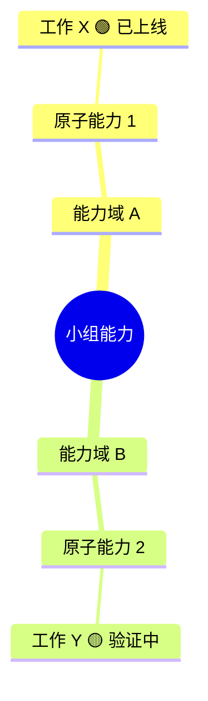
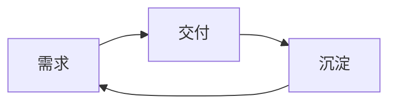

```callout
**阶段结论**：这里写结论。
- 关键数字一
- 关键数字二
```
## 一、全景思维导图

## 二、进展总表
| **方向** | **工作** | **状态** |
| --- | --- | --- |
| 方向 A | 工作 X | 🟢 已上线 |
## 三、边界与支持
```grid
**能力边界**
- 边界一
---col---
**需要的支持**
- 支持一
```
## 四、下一步
- [ ] 待办一

