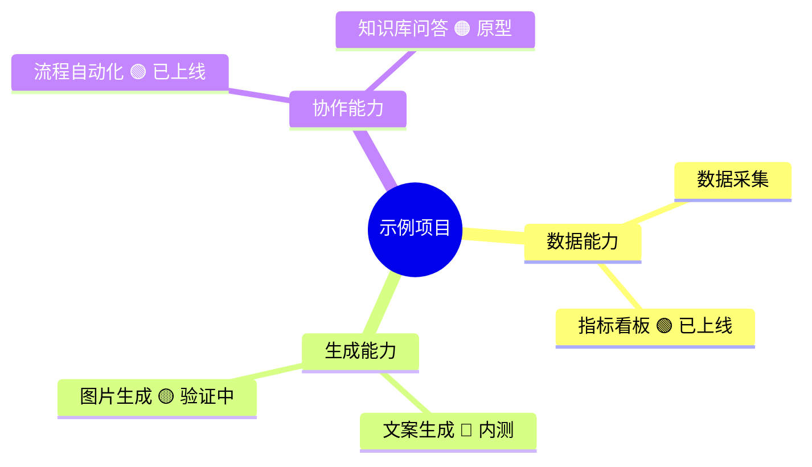
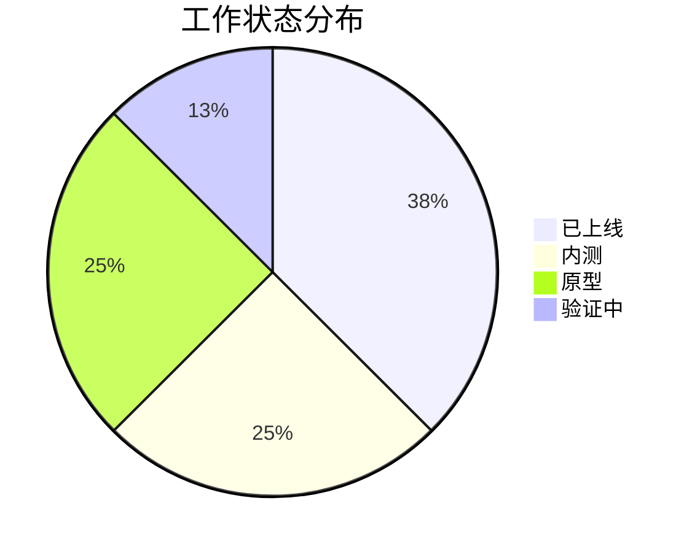
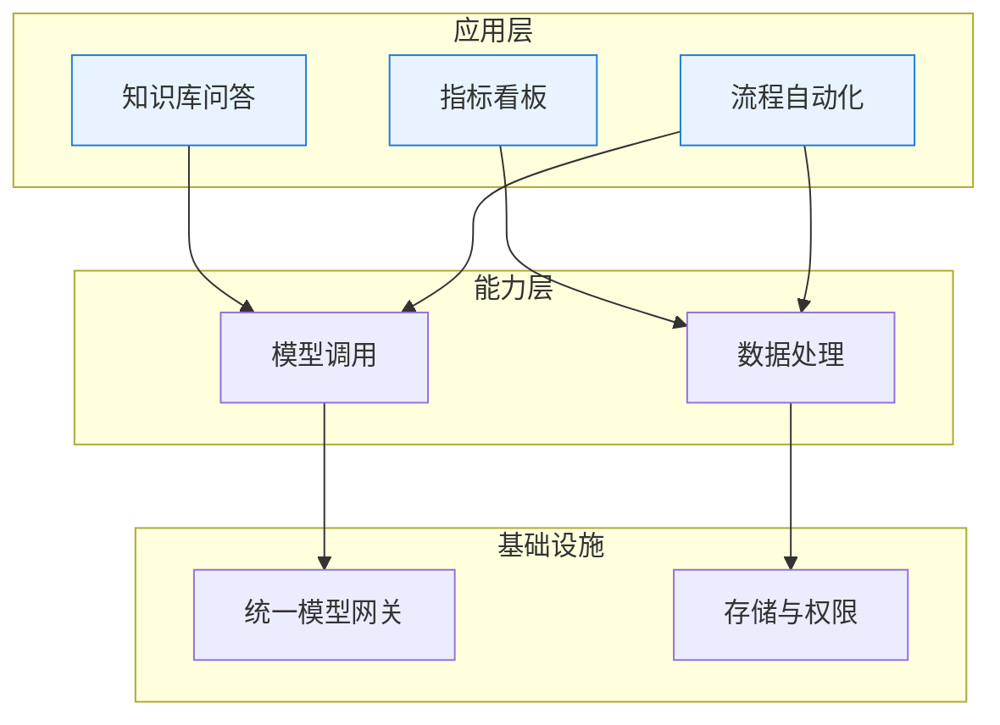
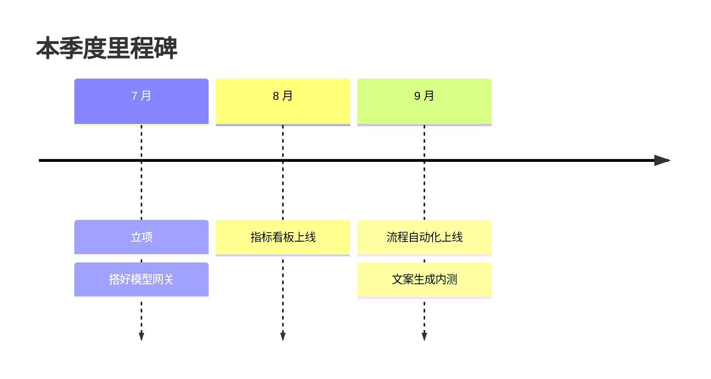
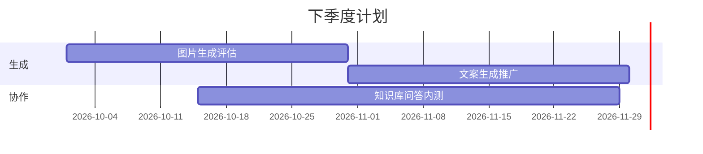
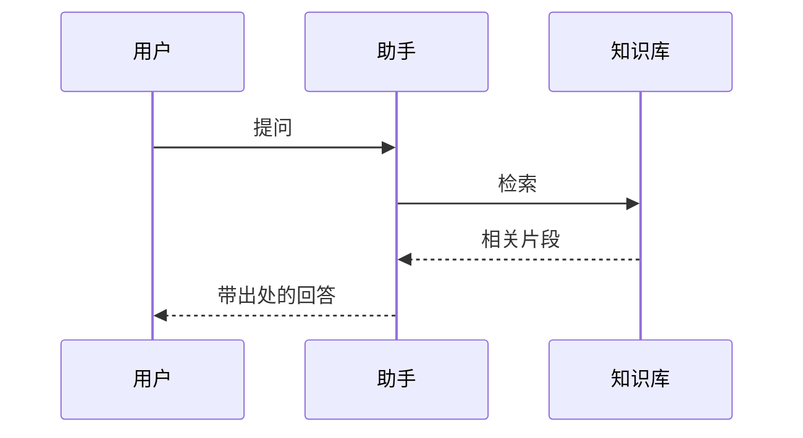

```callout blue 💡
**阶段结论**：示例项目本季度完成 3 个功能上线，2 个进入内测，交付周期从两周缩短到一周。
- 这一部分写给领导看，三五行讲清楚做了什么、结果如何、需要什么
```
## 核心数据
```grid grey 🧩 | grey ✅
#### 12 项能力
{grey:沉淀为可复用的基础能力}
---col---
#### 8 项工作
{grey:其中 3 项已上线、2 项内测}
```
```grid grey ⏰ | grey 📈
#### 1 周
{grey:平均交付周期（原 2 周）}
---col---
#### 40%
{grey:重复性工作减少比例}
```
## 一、能力全景
> 小组目前具备的能力和对应的工作。

## 二、工作分布

## 三、整体架构

## 四、进展总表
> 每项工作的方向和当前状态。
| **方向** | **工作** | **状态** | **说明** |
| --- | --- | --- | --- |
| 数据 | 指标看板 | 🟢 已上线 | 每日自动更新 |
| 协作 | 流程自动化 | 🟢 已上线 | 覆盖 5 个流程 |
| 生成 | 文案生成 | 🔵 内测 | 3 名同事试用 |
| 生成 | 图片生成 | 🟡 验证中 | 效果待评估 |
| 协作 | 知识库问答 | 🟠 原型 | 已有演示版本 |
## 五、里程碑


## 六、主要流程

## 七、边界与需要的支持
```grid orange ⚠️ | green 🤝
**目前做不到的**
- 涉及审批的流程还需要人工确认
- 图片生成的质量不稳定
---col---
**需要的支持**
- 模型调用额度
- 业务方提供真实场景
```
## 八、下一步
- [ ] 图片生成完成效果评估
- [ ] 知识库问答进入内测
- [ ] 整理一份对外分享材料
