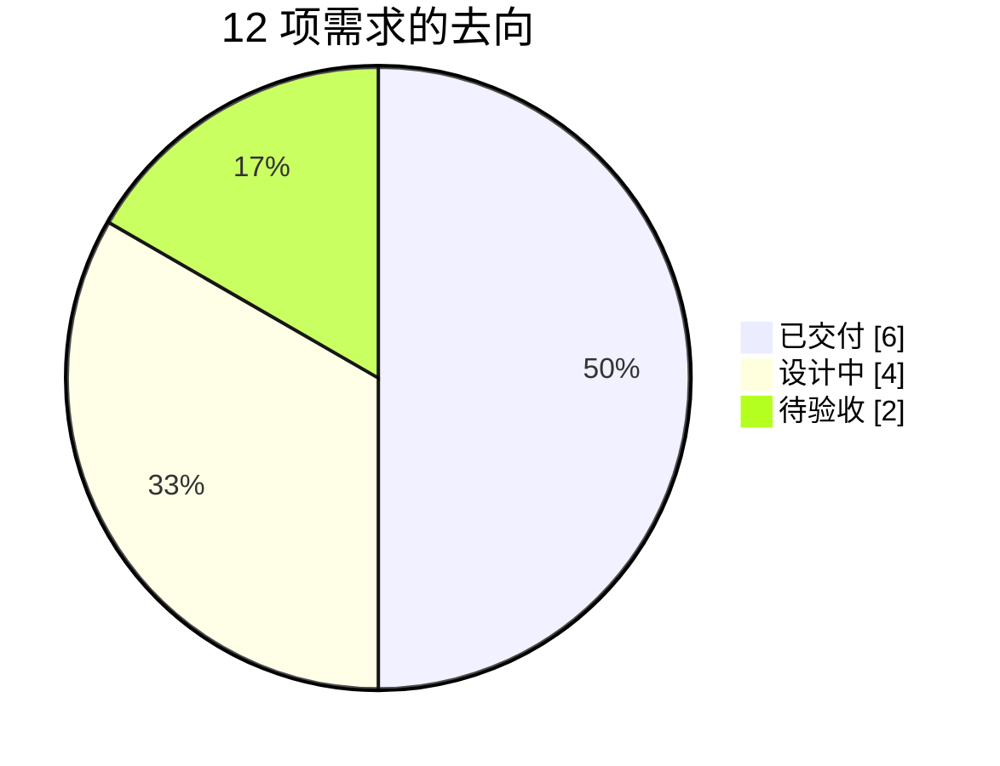
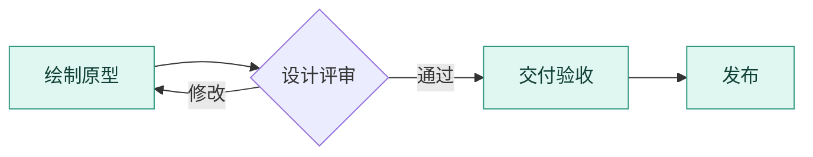
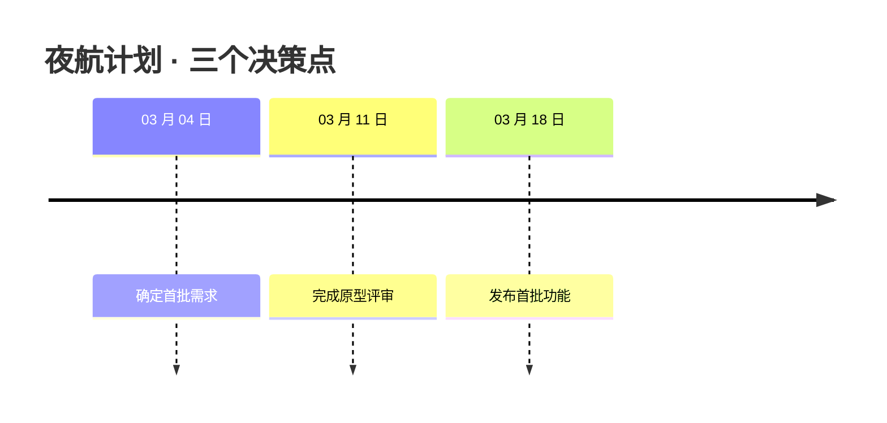

## 夜航设计实验室 · 交付简报
同一组虚构数据，四种看法。读完这页，你应该能回答：做完了多少、卡在哪里、下一步由谁决定？

### 01　交付温度计

```grid green ✅ flat | blue 🎯 flat | orange 📌 flat
#### 6 项已交付
已完成发布
---col---
#### 4 项设计中
正在绘制原型
---col---
#### 2 项待验收
等待走查确认
```

### 02　剩下的工作在哪里？
已交付占一半；剩下 6 项中，有 2 项在等验收。饼图适合看构成，精确数量留在上方卡片中。



### 03　一项需求怎样抵达发布？
评审通过后进入验收；未通过时，设计师带着批注回到原型。这张图适合做跨角色交接说明。



### 04　从一张原型到一次发布
时间线只保留三个决策点：选题、评审、发布。双击画板可放大查看。



### 复用这一页
把卡片里的数字、饼图里的数量和时间线里的日期换成同一批项目数据。以上均为演示素材。
