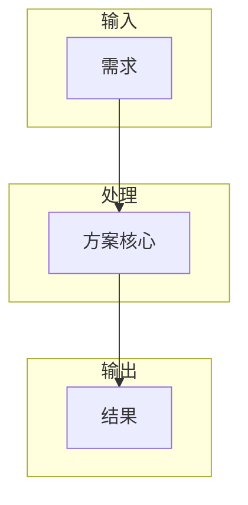

```grid grey ⏰ flat | grey 📆 flat | grey 👤 flat
**版本**：v1.0
---col---
**日期**：2026-11-19
---col---
**负责人**：组员
```
| **时间** | **版本** | **变更人** | **主要变更内容** |
| --- | --- | --- | --- |
| 2026-11-19 | v1.0 | 组员 | 初稿 |
## 一、背景
> 为什么要做，现状和问题是什么。
- 现状：
- 问题：
```callout blue 🎯
**目标**：要达成的可衡量结果
```
## 二、方案
> 方案的整体思路和关键设计。

| **模块** | **功能** | **说明** |
| --- | --- | --- |
| 模块一 | 功能 | 详细说明 |
## 三、对比与取舍
```grid plain | plain | plain
{{green:优势}}
- 优势一
---col---
{{red:劣势}}
- 劣势一
---col---
{{blue:备选方案}}
- 备选一
```
## 四、计划与资源
- **里程碑**：
- **需要的资源**：
```callout red 🚨
**风险**：主要风险和应对
```
